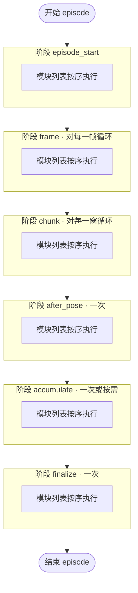
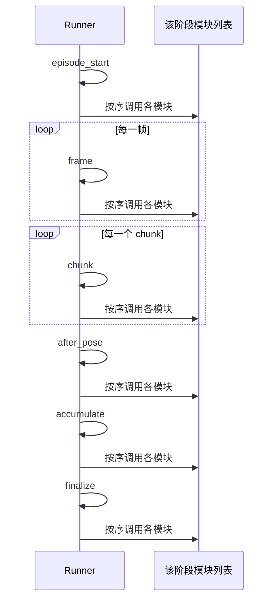
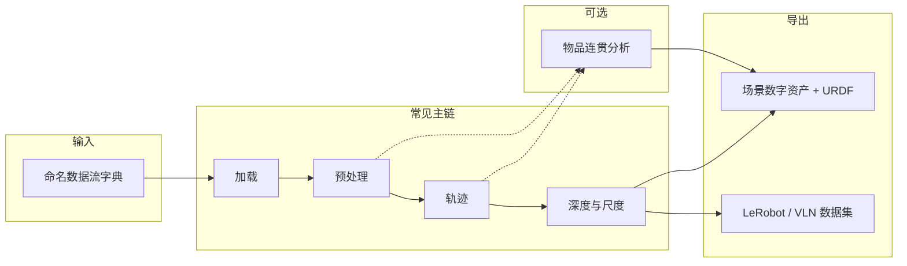
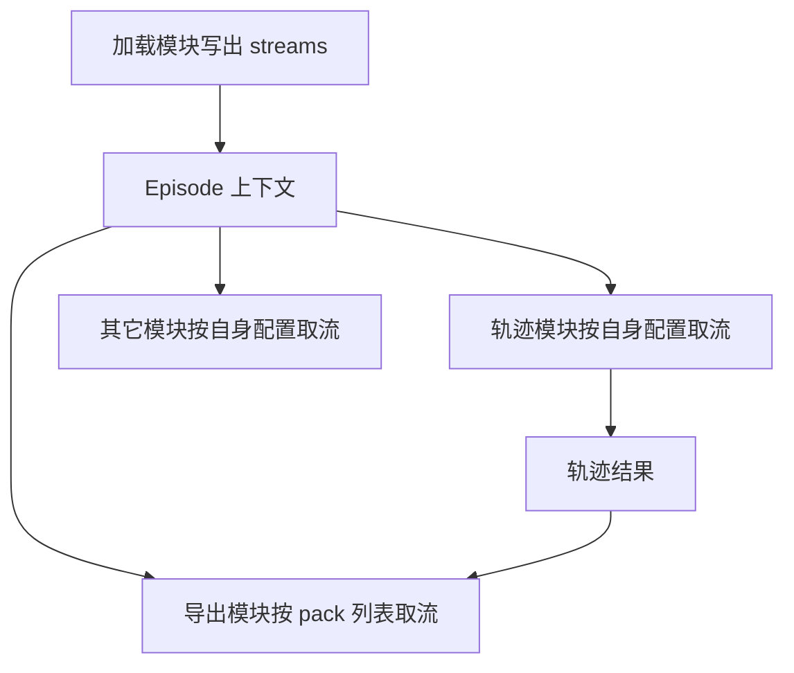
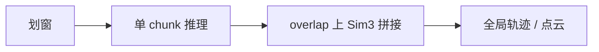
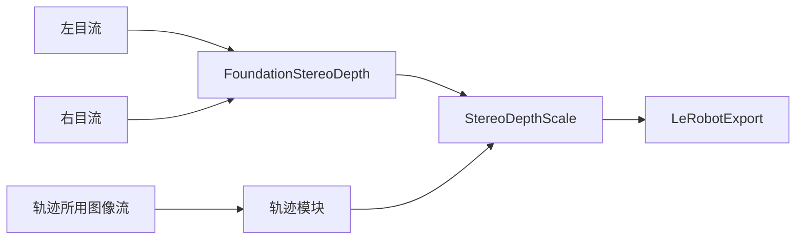

# EgoNavForge 开源框架设计

工作名暂定 EgoNavForge。目标：默认模板能跑通；用户可以自己加模块，改 YAML 拼工作流，而不必改框架主干。

文中流程图为 Mermaid，可贴飞书或到 mermaid.live 导出图片。

---

## 1. 要解决什么问题

输入是视觉相关数据，常见是视频或图像序列，也可以带 IMU、深度、多相机等。具体要哪些流，由工作流里挂的模块决定，框架不写死只能有一条正视视频。

输出可以只要其一，也可以两个都要：

1. VLN 或同类训练用的导航数据集，先以 LeRobot 为例。核心是轨迹，再配上需要写进数据集的图像、IMU 等。
2. VLN-verse 可用的场景数字资产。场景里按同一条轨迹挂上机器狗等 URDF，仿真中走出和视频一致的导航路径。

路径概括：采集数据进来 → 得到米制轨迹 → 训导航 / 进仿真复现。

---

## 2. 和现有流水线的关系

当前已跑通的 Pi3 + MoGe/深度 → LeRobot，会收成一套默认模板，不是框架的全部。模板里包括：

| 现有能力 | 框架里落在哪 |
|----------|----------------|
| 读 parsed episode、rgb.mp4、depth、slam 元数据 | 加载模块 |
| 固定夹爪 mask、YOLO 涂黑人 | 预处理模块 |
| Pi3 按 chunk 重建，overlap 上做 pose-aware Sim3 拼接，保证边界 yaw 连续 | Pi3XRecon 及其内部步骤 |
| MoGe 或传感器深度定尺度，可同时出两套对比 | 深度模块 + 尺度模块 |
| 导出时定水平面，得到 xy 与 yaw；蹲伏段处理 z | LeRobotExport 及其内部步骤 |
| 任务句、DATASET.md、可视化 | 导出 / 可视化相关配置 |

重力对齐目前常用相机朝下轴估计竖直方向；有可靠 IMU 时，可用 IMU 定水平面和朝向，作为导出或轨迹后处理里的一种实现。

默认模板里 Pi3 只读一路图像，这是 **Pi3 模块自己的输入约定**，不是框架原则。用户换成多视角轨迹模块时，在该模块配置里声明多路输入即可；导出要打包哪些流，用 `pack` 单独列出。

---

## 3. 几条原则

1. 工作流由人用 YAML 定义。我们提供模板，不是唯一合法路径。
2. 模块可开关、可排序。同一生命周期阶段里，按列表顺序执行。用户可以注册自己的大模块，与官方模块同一套机制。
3. 输入是命名数据流字典。每个模块自己声明要读哪些流；导出时单独用 `pack` 列出要进数据集的流。二者不必相同。
4. 模块可以带任意配置字典。步骤多的实现可以在自己配置里再写内部步骤列表，这是模块作者的组织方式，不是强迫所有人先理解两套「宇宙」。
5. 换算法是换模块或换模块配置，例如双目深度换成 Monster，不必改尺度主逻辑。

---

## 4. 生命周期

Runner 按固定阶段推进一个 episode。每个阶段有一个模块列表；列表可空则跳过该阶段。

| 阶段 | 何时 | 典型用途 | 现有流水线对应 |
|------|------|----------|----------------|
| episode_start | 每个 episode 开始时一次 | 读流字典、枚举帧、对齐时间戳 | 读 parsed / bag |
| frame | 对每一帧或每个抽帧 | 剔除、单帧深度、单帧分割 | mask、YOLO、单帧深度 |
| chunk | 对每一个时间窗 | 需要窗口的重建与块间衔接 | Pi3 chunk + overlap 拼接 |
| after_pose | 整段位姿就绪后一次 | 尺度、轨迹平滑 | MoGe / depth scale |
| accumulate | 需要跨帧汇总时 | 物品连贯分析等 | 为场景预留 |
| finalize | episode 结束前 | 导出数据集、建场景、可视化 | LeRobot 导出、viz |

阶段顺序固定；阶段内部顺序由 YAML 列表决定。某个阶段一个模块都不配，就进入下一阶段。





---

## 5. 总览



主链默认走到数据集导出；虚线可选。物品分析可插在预处理后或轨迹后，由配置顺序决定。场景模块不配或关掉即可。

---

## 6. 数据如何进入

### 6.1 输入是带名字的流

加载模块在 `episode_start` 解析配置，写出统一的 `streams`。字段名随采集习惯变化，例如：

```json
{
  "image": "path1/vid.mp4",
  "imu": "file.json"
}
```

```json
{
  "forward_img": "path1/",
  "left_img": "path2/",
  "right_img": "path3/",
  "imu": "file.json"
}
```

数据参数写在加载模块自己的配置上，挂在 pipeline 里，不再平行维护一份与加载模块重复的顶层 `data`。

### 6.2 模块读哪些流：由该模块配置

框架不规定轨迹只能吃一路图。

- 默认模板的 **Pi3XRecon** 配置 `image_key: forward_img`，只读这一路。
- 用户的多视角轨迹模块可配置 `image_keys: [cam0, cam1, cam2]`，或其它它需要的字段。
- 深度、分割等同理：各模块写清自己依赖的流名。

### 6.3 导出打包：用 pack 显式列出

写成 LeRobot 时，要进 observation 的流必须列出，例如 `pack: [forward_img, left_img, right_img, imu]`。

`pack` 与轨迹模块读哪些流没有绑定：

| 情况 | 轨迹模块读取 | pack |
|------|--------------|------|
| 现有 Pi3 模板 | 一路图像 | 可以一路，也可以三路都进数据集 |
| 多视角轨迹模块 | 多路图像 | 按训练需要列出，可与输入相同或为子集 |
| 只要轨迹调试 | 模块所需流 | pack 可以很短 |



加载后内部形态示例：

```text
streams[name] = 视频或帧列表或 IMU 表
pack = ["forward_img", "left_img", "right_img", "imu"]
```

---

## 7. 模块是什么

模块是挂在某个生命周期阶段上的可执行单元，用 `type` 注册和创建。官方提供一批常用模块；用户可注册自己的大模块，用法相同。

按用途归类只为好找：

| 用途 | 官方示例 | 常见阶段 |
|------|----------|----------|
| 加载 | ParsedUmiLoader、DictStreamLoader | episode_start |
| 预处理 | FixedGripperMask、YOLOPersonFilter | frame |
| 轨迹 | Pi3XRecon；用户可换多视角实现 | chunk 等 |
| 深度 / 尺度 | MoGeDepth、MoGeScale、StereoDepthScale | frame / after_pose |
| 跨帧理解 | ObjectMemory | accumulate 或 frame |
| 场景 | SceneBuild | finalize |
| 导出 | LeRobotExport | finalize |

步骤多的模块可以在配置里再写内部步骤。下面用现有流水线说明「可以怎么拆」，方便迁移，不是要求每个模块都必须再套一层。

---

## 8. 现有流水线能力对照

### 8.1 数据加载

- 解析视频、帧目录、depth、slam、IMU json。
- 写出 `streams` 与默认 `pack`。
- `image_stride` 抽帧可写在加载或预处理配置里。

### 8.2 预处理

| 步骤 | 作用 |
|------|------|
| FixedGripperMask | 固定夹爪区域硬剔除或涂黑 |
| YOLOPersonFilter | 高置信行人框涂黑，减轻动态物干扰重建 |
| 可扩展 SAM 等 | 语义动态物剔除 |

一般先夹爪 mask，再 YOLO；顺序可配。作用在哪一路图像，由该步骤自己的 `image_key` 决定。

### 8.3 轨迹 Pi3XRecon

| 步骤 | 作用 |
|------|------|
| ChunkScheduler | 按 `chunk_size`、`overlap` 划窗 |
| Pi3Infer | 单 chunk 出相对位姿与点云 |
| ChunkStitch | 在 overlap 上做 pose-aware Sim3：旋转保证衔接处朝向连续，尺度用相机中心 Umeyama 并钳制；旧版只拼中心会导致边界 yaw 跳变 |
| PointMerge | 拼接后的全局点云合并 |

长序列分块后的一致性主要靠 ChunkStitch。若用户不用 Pi3，这些步骤随用户自己的轨迹模块而定，不必沿用 chunk 语义。



### 8.4 深度与尺度

深度与尺度拆开，便于多路对比。

| 模块 | 作用 |
|------|------|
| MoGeDepth / SensorDepth / FoundationStereoDepth | 出深度图 |
| MoGeScale / SensorDepthScale / StereoDepthScale | 用某一 key 的深度把位姿拉到米制 |
| ScaleEnsemble | 可选，对比或融合多路尺度 |

现有 `--scale-mode moge|depth|both` 对应开一路或两路尺度，结果写到不同名字下。

### 8.5 导出 LeRobotExport

| 步骤 | 作用 |
|------|------|
| GravityOrImuAlign | 变到 Z 朝上的导航坐标；可用相机轴估计重力，或改用 IMU |
| PoseToXYZYaw | 水平面投影得 x、y，由前向轴得 yaw；相对首帧原点 |
| SquatZMap | 有「蹲」标注时 z 做 0 → 低点 → 0；无则 z 置 0 |
| TaskPromptBind | 绑定 search_object 等任务句 |
| PackObservations | 按 `pack` 写入多路图像、IMU 等 |
| WriteLeRobotLayout | parquet、videos、meta、可选 DATASET.md 与 zip |

「用 IMU 定平面和方向」落在导出或轨迹后处理的对齐步骤里，而不是另起一个与导出无关的顶层阶段。

### 8.6 可视化与质检

| 能力 | 作用 |
|------|------|
| TrajCompareViz | XY、yaw 展开、chunk 边界 \|dyaw\| |
| EgoPointCloudViz | 第一人称点云漫游，默认关，费磁盘 |
| QualityGate | 边界 yaw 跳变、自旋可疑等标记 |

### 8.7 物品连贯分析与数字资产

现有主链尚未做成完整数字资产，框架预留：

- ObjectMemory：按帧分割与跨帧合并，供后面场景用；
- SceneBuild：点云或 SimFoundry、Blender 等；
- VLNVersePackager：场景 + 轨迹 + URDF。

不要孪生时全部关闭即可。物品分析与数字资产拆开：中间跨帧攒实例，最后再转换资产。

---

## 9. 配置示例

### 9.1 默认 Pi3 模板

数据写在加载模块上。Pi3 用 `image_key` 读单路；`pack` 可列出更多相机进数据集。

```yaml
exp_name: umi_default
work_dir: ./work_dirs/umi_default

pipeline:
  - stage: episode_start
    modules:
      - type: DictStreamLoader
        enabled: true
        streams:
          forward_img: /data/ep0/forward/
          left_img: /data/ep0/left/
          right_img: /data/ep0/right/
          imu: /data/ep0/imu.json
        pack: [forward_img, left_img, right_img, imu]
        image_stride: 2

  - stage: frame
    modules:
      - type: FixedGripperMask
        enabled: true
        image_key: forward_img
        mask_path: assets/mask_first_frame.png
      - type: YOLOPersonFilter
        enabled: true
        image_key: forward_img
        conf: 0.55
        weights: assets/yolov8s.pt

  - stage: chunk
    modules:
      - type: Pi3XRecon
        enabled: true
        image_key: forward_img
        chunk_size: 160
        overlap: 40
        stitch: pose_join_R_clamped_s
        checkpoint: checkpoints/Pi3X_model.safetensors

  - stage: after_pose
    modules:
      - type: MoGeDepth
        enabled: true
        image_key: forward_img
        name: moge
      - type: MoGeScale
        enabled: true
        depth_key: moge

  - stage: finalize
    modules:
      - type: LeRobotExport
        enabled: true
        align: camera_y_mean    # 可改为 imu_gravity
        squat_z_low_m: -0.25
        write_md: true
      - type: SceneBuild
        enabled: false
```

需要把 Pi3 或导出的内部步骤写得更细时，可以在该模块配置里再加 `steps` 列表，例如：

```yaml
      - type: LeRobotExport
        enabled: true
        steps:
          - type: GravityOrImuAlign
            mode: camera_y_mean
          - type: PoseToXYZYaw
          - type: SquatZMap
            z_low_m: -0.25
          - type: PackObservations
          - type: WriteLeRobotLayout
            write_md: true
```

这是该模块可选的写法，不是每个模块的必选项。

### 9.2 用户自研多视角轨迹

```yaml
pipeline:
  - stage: episode_start
    modules:
      - type: DictStreamLoader
        enabled: true
        streams:
          cam0: /data/ep0/cam0/
          cam1: /data/ep0/cam1/
          cam2: /data/ep0/cam2/
          imu: /data/ep0/imu.json
        pack: [cam0, cam1, cam2, imu]

  - stage: chunk
    modules:
      - type: MyMultiViewPose
        enabled: true
        image_keys: [cam0, cam1, cam2]

  - stage: finalize
    modules:
      - type: LeRobotExport
        enabled: true
        pack: [cam0, cam1, cam2, imu]
```

### 9.3 双目尺度



换成 Monster：只换深度模块的 `type`，尺度仍用 StereoDepthScale，`depth_key` 指向新结果名。

---

## 10. 工作流模板

| 模板 | 做法 |
|------|------|
| 现有 UMI 默认 | 加载 + mask/YOLO + Pi3 单路 + MoGe 尺度 + LeRobot |
| 深度尺度对照 | 换或加传感器深度尺度 |
| 双目尺度 | 加双目深度与对应尺度模块 |
| 多视角轨迹 | 换用户轨迹模块，并改其输入流与 pack |
| 只要数据集 | 不配场景模块 |
| 数据集 + 孪生 | 加物品分析与场景导出 |

---

## 11. 仓库结构

```text
ego_nav_forge/
├── README.md
├── configs/presets/
├── src/ego_nav_forge/
│   ├── runner.py
│   ├── context.py
│   ├── registry.py
│   └── modules/
│       ├── ingest/
│       ├── preprocess/
│       ├── pose/
│       ├── depth/
│       ├── scale/
│       ├── object_memory/
│       ├── scene/
│       ├── export/
│       └── viz/
├── backends/
├── examples/
├── tests/
└── docs/
```

现有 `pi3_moge_lerobot` 收成 preset，实现尽量从现有脚本迁入并保持数值对齐。

---

## 12. 落地顺序

1. Runner：阶段推进、模块列表、开关；用自定义假模块测顺序。
2. 加载模块写出 `streams` 与默认 `pack`；Pi3 模板用 `image_key` 读单路，导出按 `pack` 打包。
3. 把拼接、平面对齐、蹲伏 z 等写进对应模块配置，与现网数值对齐。
4. 深度与尺度拆开，接一种双目，预留 Monster。
5. 用一个多视角假轨迹模块验证：模块输入流与 `pack` 可独立配置。
6. ObjectMemory 与 SceneBuild 最小版，再接重场景后端，并保持可关。

---

## 13. 结论

1. Runner 按生命周期阶段推进；每个阶段是可编辑的模块列表。用户可注册自己的大模块。
2. 各模块自行声明读哪些流；导出用 `pack` 显式列出要进数据集的流。Pi3 单路图像只是默认模板的选择，不是框架原则。
3. 现有 UMI 流水线的 chunk 拼接、mask/YOLO、尺度、导出后处理等，都作为模块或其配置中的步骤保留；工作流由 YAML 定义，模板只是起点。
